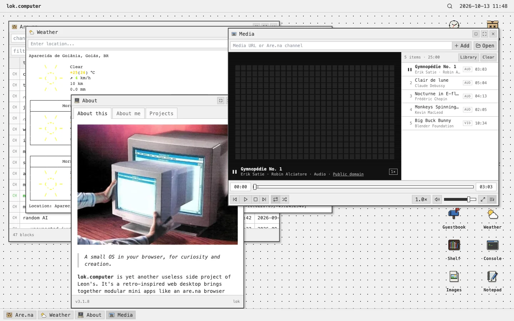
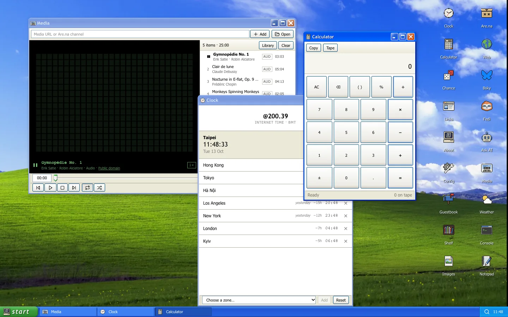
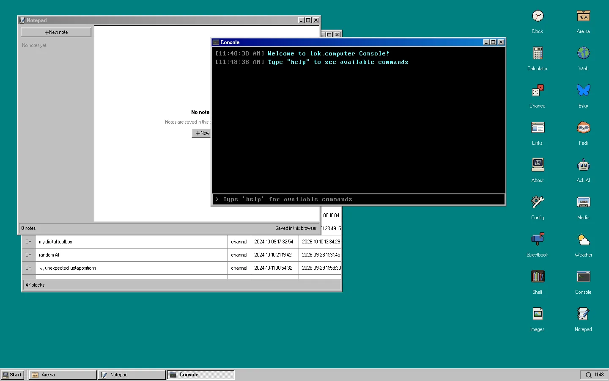
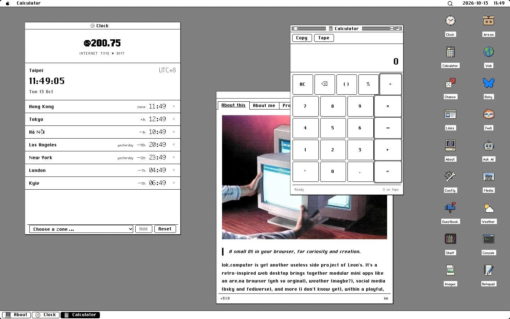

# lok.computer

[](https://github.com/l3ony2k/lok-computer/actions/workflows/ci.yml)

A small operating system in your browser, for curiosity and creation.

**[lok.computer](https://lok.computer)** is my personal site, built as a retro desktop: draggable windows, a taskbar or menu bar, desktop icons, and a dozen small apps, most of them windows onto things I collect and write elsewhere ([Are.na](https://www.are.na/lok), the fediverse, NeoDB). It wears ten skins, from a flat monochrome default to Windows 98, Mac System 6 and BeOS.



<table>
  <tr>
    <td></td>
    <td></td>
    <td></td>
  </tr>
</table>

## What's inside

**The desktop**
- Windows that drag, resize, snap to screen edges, minimise, maximise and roll up into their title bar
- Desktop icons you can rearrange, right-click menus, and a keyboard launcher (<kbd>⌘K</kbd> / <kbd>Ctrl K</kbd>)
- Your windows, their positions and each app's view come back after a reload (IndexedDB)
- Deep links for every window (`/weather`, `/explorer/<channel>`, `/open?w=about,media`)
- Works offline: feeds and lookups show their last saved copy; installable as a PWA

**Apps**

| | |
|---|---|
| **Are.na** | Browse channels and blocks; open images, media and links from them |
| **Media** | Cassette-deck audio and video player with a spectrum analyser; plays Are.na channels |
| **Images** | Image viewer and Are.na gallery with zoom and pan |
| **Ask AI** | One question in, a calibrated answer out (a planner model plus [TypeSafe Jev](https://typesafe.ai)) |
| **Bsky** / **Fedi** | My Bluesky and fediverse posts |
| **Shelf** | What I'm reading and watching, from NeoDB |
| **Weather** | Forecasts from wttr.in |
| **Notepad**, **Clock**, **Calculator**, **Chance** | Small desk tools (Chance rolls dice, flips coins, deals cards and draws tarot) |
| **Console** | A command line for the desktop (`help`, `apps open`, `theme`, `play`) |
| **Web**, **Links**, **Guestbook**, **About**, **Config** | The rest of the furniture |

**Themes:** lok (light and dark), 98, XP, 7, System, TUI, 386, CS 1.6, BeOS and Palm. Each skin is a lazily loaded stylesheet over shared tokens, so every app recolours with it. Most build on an open-source CSS library; see [Credits](#credits).

**For machines:** an [OpenAPI document](https://lok.computer/openapi.json), [`llms.txt`](https://lok.computer/llms.txt) and Markdown versions of the main pages for AI agents.

## Running it locally

You need [Bun](https://bun.sh), at the version pinned in `package.json` (`packageManager`). An older Bun can't read the `bun.lock` a newer one writes.

```bash
bun install --frozen-lockfile
bun dev              # http://localhost:8080
```

During development, `/api/*` requests go to the deployed site (`VITE_SITE_URL`, lok.computer by default), so Ask AI, Fedi and Shelf work without credentials. To run the Worker yourself, start `bunx wrangler dev` (with a `.dev.vars` file holding the secrets below) and point the dev server at it:

```bash
LOK_API_ORIGIN=http://localhost:8787 bun dev
```

Before sending a change, run all four checks:

```bash
bun run lint
bun run typecheck    # the app, the Worker and Pages function, and the Vite config
bun test
bun run build
```

[CI](.github/workflows/ci.yml) runs the same four with the pinned Bun on every push to `main` and every pull request.

## Deploying

The site has two parts on Cloudflare:

1. **The frontend on Cloudflare Pages.** Build command `bun run build`, output directory `dist`. `functions/[[path]].ts` serves Markdown to agents and returns real 404s for unknown paths; `public/_routes.json` sends `/api/*` to the Worker.
2. **The API Worker** (`worker/worker.js`, with the Ask AI pipeline in `worker/jev.js`), deployed by hand with `bunx wrangler deploy`. It holds every credential, so none reach the browser.

| Worker setting | Kind | Used by |
|---|---|---|
| `AI_BASE_URL`, `AI_API_KEY` | secret | Ask AI planner (any OpenAI-compatible endpoint) |
| `JEV_PLANNER_MODEL` | var, required | Ask AI planner model |
| `JEV_PLANNER_REASONING_EFFORT` | var, optional | Planner reasoning effort (default `none`) |
| `TYPESAFE_API_KEY` | secret | Ask AI answers (Jev) |
| `JEV_MODEL` | var | Jev model (default `jev-latest`) |
| `FEDI_INSTANCE`, `FEDI_ACCESS_TOKEN` | var, secret | Fedi app |
| `NEODB_USERNAME`, `NEODB_ACCESS_TOKEN` | var, secret | Shelf app |
| `JEV_RATE_LIMITER`, `PROXY_RATE_LIMITER` | binding | Per-IP rate limits, declared in `wrangler.toml` |

Set secrets with `bunx wrangler secret put <NAME>`. Wrangler deploys to the account you're logged in to, or to `CLOUDFLARE_ACCOUNT_ID` when your login reaches several. Deploy the Worker before pushing when `worker.js`, `jev.js` or `wrangler.toml` changed. [docs/worker-api.md](docs/worker-api.md) has the endpoints in detail.

## Making your own

Fork it, then swap out what's mine:

1. **Build settings.** Set these on your Pages project (or in `.env.local`; see [`.env.example`](.env.example)). Each one falls back to lok.computer's value when unset ([`src/config/deployment.ts`](src/config/deployment.ts)):

   | Variable | What it sets |
   |---|---|
   | `VITE_SITE_URL` | Your domain: canonical and social-card URLs, and the analytics domain guard |
   | `VITE_UMAMI_SRC`, `VITE_UMAMI_WEBSITE_ID` | Your Umami tracker; set either to empty to turn analytics off. The tag only reports from `VITE_SITE_URL`'s domain, so a fork never counts into my statistics. |
   | `VITE_ARENA_USERNAME` | The Are.na account the desktop browses |
   | `VITE_BSKY_ACTOR` | The Bluesky account (DID or handle) in the Bsky app |
   | `VITE_FEDI_USERNAME` | The fediverse account in the Fedi app |
   | `VITE_GUESTBOOK_ID` | Your guestbooks.meadow.cafe guestbook |

2. **Worker settings** in `wrangler.toml`: `FEDI_INSTANCE` and `NEODB_USERNAME`, plus the secrets in the table above.
3. **[`src/config/site.ts`](src/config/site.ts):** the About window's quote, bio, links and projects, the repository link, and the Browser's bookmarks.
4. **Everything else that's mine:** the `rel="me"` links, author and Twitter tags in `index.html`; the About text and changelog in `src/apps/about/`; the Links app and the 88×31 buttons in `src/assets/buttons/` and `public/`; the favicon and social image; `llms.txt`, `agent-instructions.md`, `openapi.json`, `sitemap.xml` and `robots.txt` in `public/`; `functions/agent-content.ts`.

The lok.computer name, the L3 logo and my writing aren't part of the licence (see below), so replace them rather than reuse them.

Under the AGPL, if you run a modified copy as a website, you have to offer its visitors the source code. A link to your fork in the About window is enough.

## Documentation

| | |
|---|---|
| [Architecture](docs/architecture.md) | How the desktop, catalog, storage and Worker fit together |
| [Creating apps](docs/creating-apps.md) | Adding an app to the catalog |
| [Window system](docs/window-system.md) | Window manager, session restore |
| [Styling](docs/styling.md) | Tokens, themes, the classic component layer |
| [URL routing](docs/url-routing.md) | Deep links |
| [Worker & API](docs/worker-api.md) | The Worker's endpoints and settings |
| [Development log](docs/development-log.md) | Detailed notes for every release |

[`AGENTS.md`](AGENTS.md) holds the project's working rules, written for coding agents but useful to anyone.

## Contributing

Bug reports and small fixes are welcome; please open an issue before anything large. This is a personal site, so I may say no to features that don't fit it. Keep changes in the style of the code around them and run the four checks above.

## Credits

The theme skins are built on [98.css](https://github.com/jdan/98.css), [XP.css](https://github.com/botoxparty/XP.css), [7.css](https://github.com/khang-nd/7.css), [system.css](https://github.com/sakofchit/system.css), [TuiCss](https://github.com/vinibiavatti1/TuiCss), [BOOTSTRA.386](https://github.com/kristopolous/BOOTSTRA.386), [cs16.css](https://github.com/ekmas/cs16.css) and beos-css. [NOTICE.md](NOTICE.md) lists every third-party library, font, image and trademark in the repository with its owner and licence.

## License

The source code is licensed under the [GNU Affero General Public License v3.0 or later](LICENSE). Copyright © 2025–2026 Leon Wong.

The lok.computer name and L3 logo, my writing on the site, and the Are.na, fediverse and NeoDB content it displays are **not** covered by that licence; all rights reserved. Third-party assets keep their own terms, listed in [NOTICE.md](NOTICE.md).
